<!-- ===================== HEADER ===================== -->
<p align="center">
  
</p>

<p align="center">
  <a href="https://github.com/AhmdSobhy">
    
  </a>
</p>

<p align="center">
  <a href="https://www.linkedin.com/in/ahmedsobhymorra/"></a>
  <a href="mailto:a7mdsobhy@gmail.com"></a>
  
  <br />
  
</p>

---

<!-- ===================== ABOUT ===================== -->
<h2>
  
  Hey, I'm Ahmed
</h2>

I'm a **Flutter developer who works as a technical partner** — not a ticket-taker.
Before I write a line of code, I sit with the people who own the problem: I work the business case, study the market and competitors, challenge the proposed solution, and decide *what ships now* and *what waits for phase two*. Then I build it — clean, tested, and ready for real users.

```dart
final ahmed = Developer(
  role:        'Flutter Developer · Technical Partner',
  basedIn:     'Cairo, Egypt  →  working remotely, worldwide',
  education:   'B.Sc. Computer Science — Ain Shams University',
  focus:       ['Mobile products', 'Product scoping', 'Clean Architecture'],
  alsoComfortableWith: ['Backend for admin panels', 'Web', 'UI in Figma'],
  currently:   'Shipping my own products & partnering on client builds',
);
```

<!-- ===================== HOW I WORK ===================== -->
<h2>🧭 How I Work</h2>

<table>
  <tr>
    <td width="25%" align="center"><b>01 · Understand</b><br /><sub>Stakeholder sessions, business case, market & competitor research</sub></td>
    <td width="25%" align="center"><b>02 · Scope</b><br /><sub>Challenge the brief, cut what doesn't earn its place, plan the phases</sub></td>
    <td width="25%" align="center"><b>03 · Architect</b><br /><sub>Feature-first Clean Architecture, clear boundaries, testable by design</sub></td>
    <td width="25%" align="center"><b>04 · Ship</b><br /><sub>CI/CD, unit & widget tests, a product that's ready for real users</sub></td>
  </tr>
</table>

> I'm honest about limits: when a system needs a seasoned backend specialist, I say so and help bring the right person in. One deep specialty — mobile — backed by working knowledge of everything around it.

<!-- ===================== FEATURED WORK ===================== -->
<h2>🚀 Featured Work</h2>

<table>
  <tr>
    <td width="33%" valign="top">
      <h3>⚖️ Expert Witness Platform</h3>
      <sub><b>ExpertoLink · US legal-tech · Remote</b></sub>
      <p>A Flutter platform matching lawyers with expert witnesses. Owned more than the code — shaped scope with stakeholders, researched the market, and decided what to build now vs. later.</p>
      
      
    </td>
    <td width="33%" valign="top">
      <h3>🚗 إيرادى · Iradi</h3>
      <sub><b>My own product · Egypt</b></sub>
      <p>Net-income tracker for Uber, DiDi & Careem drivers: log earnings and expenses across apps, see real profit by day, week and month. Offline-first, Pro tier with analytics and Google Drive backup.</p>
      
      
      
    </td>
    <td width="33%" valign="top">
      <h3>📦 Distribution System</h3>
      <sub><b>Operations software · Client</b></sub>
      <p>A mobile-first web app running a distributor's daily operations end to end — supply, orders, delivery routes and supplier settlement — replacing paper and WhatsApp with one source of truth.</p>
      
      
    </td>
  </tr>
</table>

<!-- ===================== TECH STACK ===================== -->
<h2>🛠️ Tech Stack</h2>

<p align="center">
  
</p>

<p align="center">
  
  
  
  
  
  
  
  
  
  
</p>

<!-- ===================== GITHUB STATS ===================== -->
<h2>📊 GitHub Activity</h2>

<p align="center">
  
  
</p>

<p align="center">
  
</p>

<!-- Snake animation — generated by .github/workflows/snake.yml -->
<p align="center">
  <picture>
    <source media="(prefers-color-scheme: dark)" srcset="https://raw.githubusercontent.com/AhmdSobhy/AhmdSobhy/output/github-snake-dark.svg" />
    <source media="(prefers-color-scheme: light)" srcset="https://raw.githubusercontent.com/AhmdSobhy/AhmdSobhy/output/github-snake.svg" />
    
  </picture>
</p>

<!-- ===================== CTA ===================== -->
<h2 align="center">🤝 Let's Build Something</h2>

<p align="center">
  Have an idea that needs more than a developer — someone to shape it, scope it, and ship it?<br />
  <b>I'd love to hear about it.</b>
</p>

<p align="center">
  <a href="mailto:a7mdsobhy@gmail.com"></a>
</p>

<!-- ===================== FOOTER ===================== -->
<p align="center">
  
</p>
